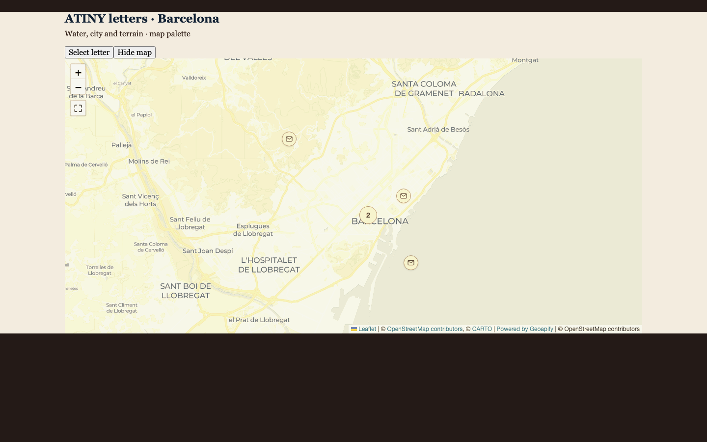
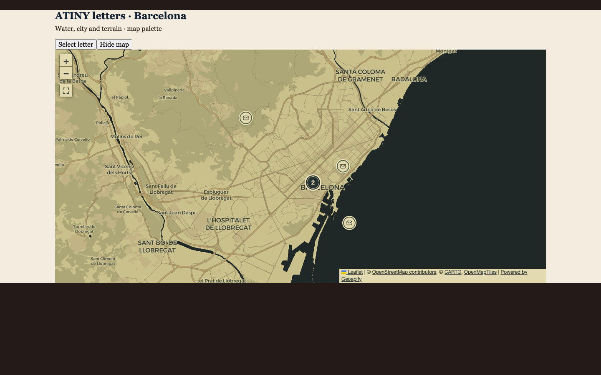
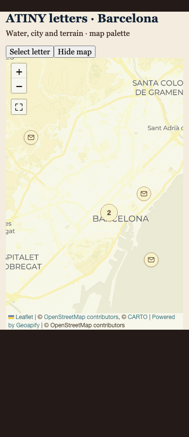
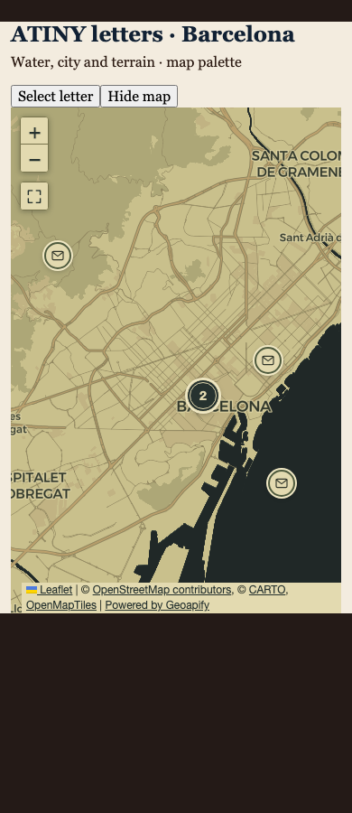
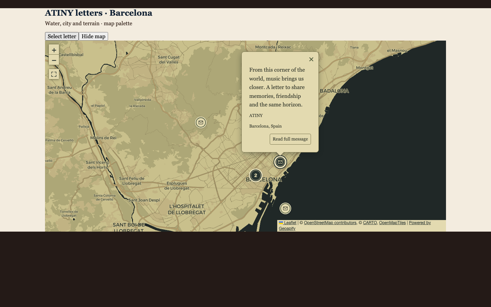
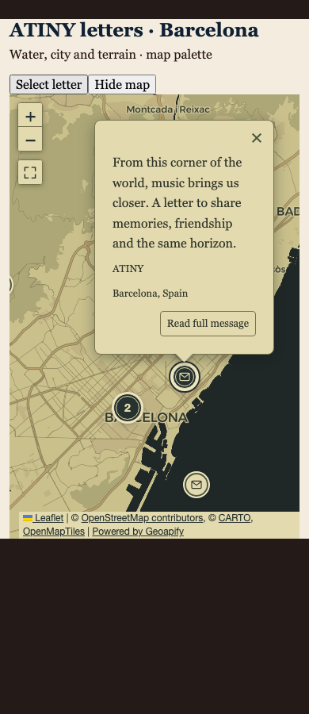
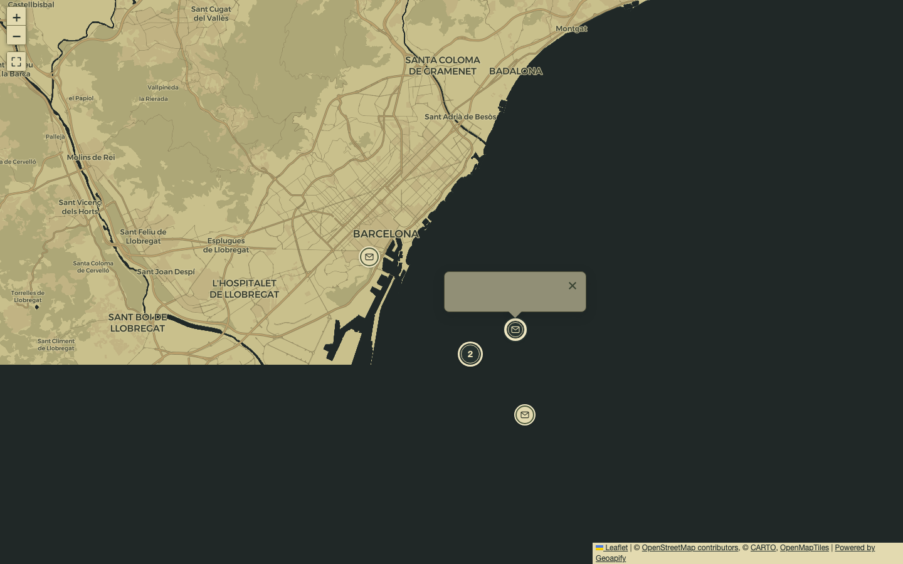
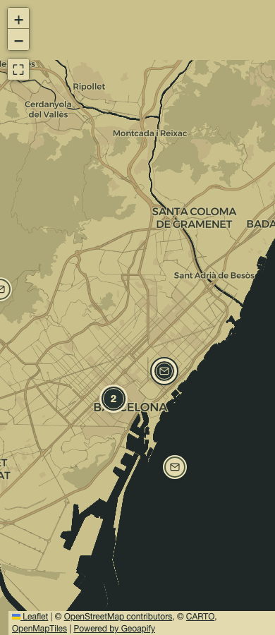
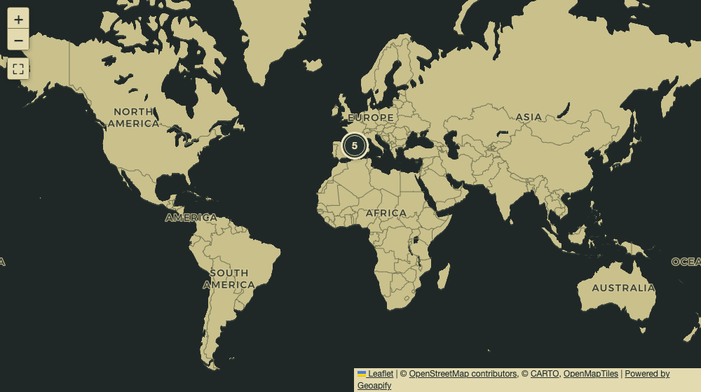
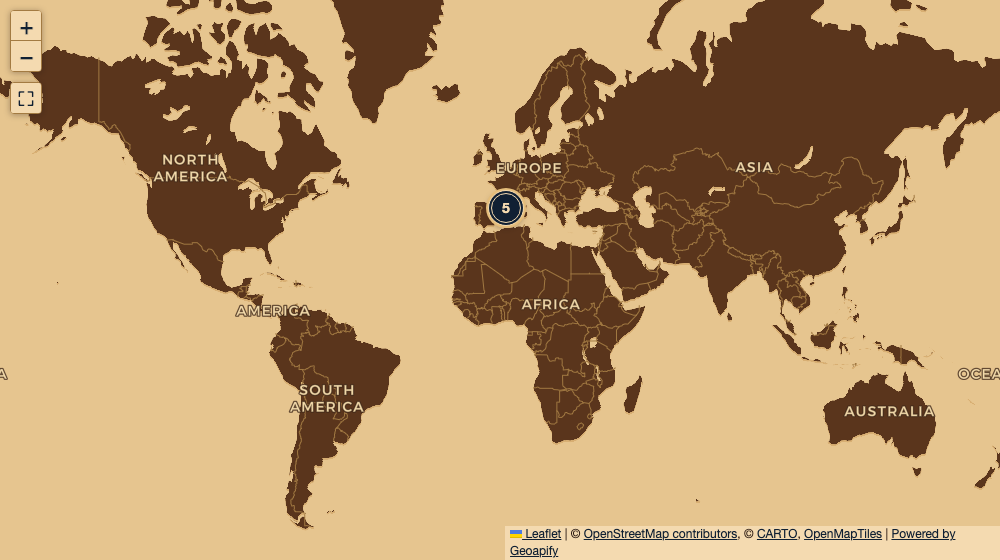

# Map palette comparison

The same production map component is rendered in a deterministic letter harness. CARTO tiles are real; letter data is a local fixture. The before/after, popup and fullscreen captures use Barcelona at latitude 41.395, longitude 2.16 and Leaflet zoom 12. Browser: Chromium. Height: 900 px. The baseline uses commit `628556c`; the updated view uses this branch.

| Viewport | Before: raster and original palette | After: vector and dark-sea atlas palette |
| --- | --- | --- |
| Desktop, 1440 px |  |  |
| Mobile, 390 px |  |  |

## Selection and popup

| Desktop | Mobile |
| --- | --- |
|  |  |

## Fullscreen

| Desktop | Mobile |
| --- | --- |
|  |  |

The screenshots show paper markers over olive parchment urban land, the charcoal sea and muted olive natural terrain, charcoal clusters and a selected letter with a double border and outer ring. Browser assertions separately check dashed keyboard focus and contrast of at least 4.5:1 for normal, selected and hovered letters, clusters, controls, popup and attribution text. The 320 px viewport is tested without adding another near-identical capture.

See [palette configuration and verification](../../map-palette.md) for editing instructions, default colors, fallback behavior and reproduction commands.

## Dark-sea atlas at world scale

The latest reference uses olive parchment continents over a charcoal sea. The world view (1024 px viewport, center 20°N / 0°, zoom 2) shows this relationship in the interactive vector map. The same palette derives dark ink, ochre cities, olive forests and brass roads for closer zooms.

The earlier nautical version is retained for comparison:

