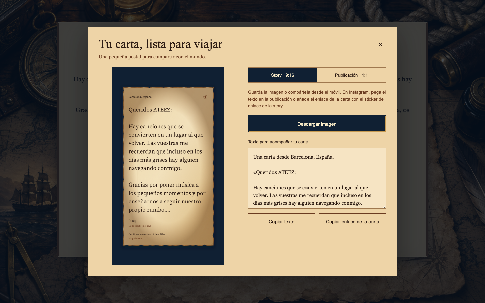
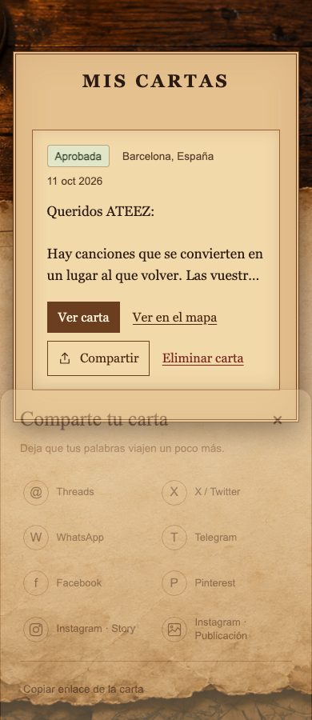
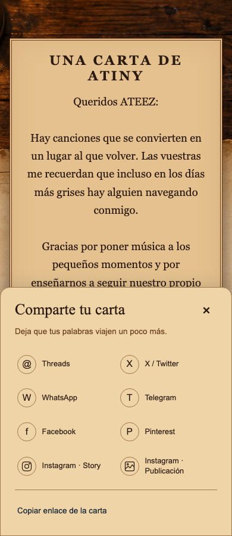
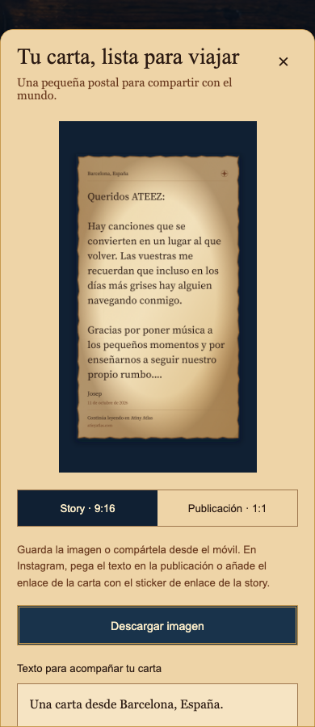
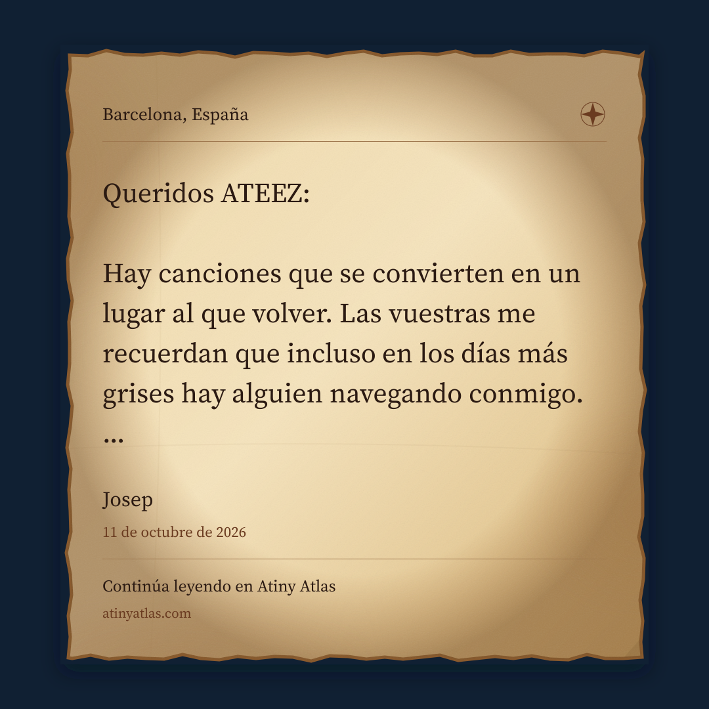

# Revisión de compartir cartas

Ruta de producto: **Mis cartas → Compartir** (también disponible en el detalle). El control aparece únicamente para el autor de una carta que siga visible públicamente.

- Threads y X envían imagen y texto por el menú nativo en dispositivos compatibles; en otros navegadores abren su compositor con extracto/enlace e imagen de vista previa. El usuario revisa y publica en la plataforma.
- WhatsApp, Telegram, Facebook, Pinterest reciben sus parámetros de compartir.
- El menú copia el enlace de la carta; si el portapapeles falla, ofrece texto seleccionable.
- Instagram ofrece Story y Publicación. En móviles compatibles, las imágenes se preparan al abrir el menú y el clic las envía al menú nativo. En otros navegadores, se abre la postal con el formato elegido para descargarla y copiar texto/enlace.
- El enlace compartido tiene metadatos e imagen horizontal propios. Cartas privadas y retiradas no alimentan los metadatos ni las rutas de imagen.

Las capturas usan la carta de ejemplo del fixture visual y los componentes reales, con PNG generados por el renderer de la aplicación. No representan una sesión autenticada en producción.

## Comprobaciones

Lint, tipos y build pasan. Pasan los escenarios BDD, la suite unitaria, integración y contratos locales. Las pruebas de navegador cubren 1440 y 390 píxeles, límites del menú, cierre con Escape, recuperación del foco, formatos, PNG real, márgenes conservados y descarga; se mantiene el resto de comprobaciones visuales existentes.

Se ha revisado el diff de forma independiente y corregido el cómputo de enlaces cortos de X y la geometría de postales/vista previa. El cálculo de X usa su parser oficial `twitter-text`; las fuentes de las imágenes se distribuyen localmente con sus licencias.

## Revisión manual pendiente

Probar los compositores externos con cuentas reales y compartir archivos en iOS/Android con Instagram instalado. El entorno local permite verificar los parámetros, las APIs del navegador y el recorrido de descarga, pero no la recepción por aplicaciones móviles físicas. Instagram no recibe una publicación automática: el enlace de una story se añade con su sticker de enlace.

La postal utiliza pergamino con borde irregular, textura de fibras y desgaste en los márgenes. El navegador no puede elegir por el usuario la aplicación nativa ni forzar el editor de Stories o el feed de Instagram; el formato preparado se entrega al menú del móvil.
